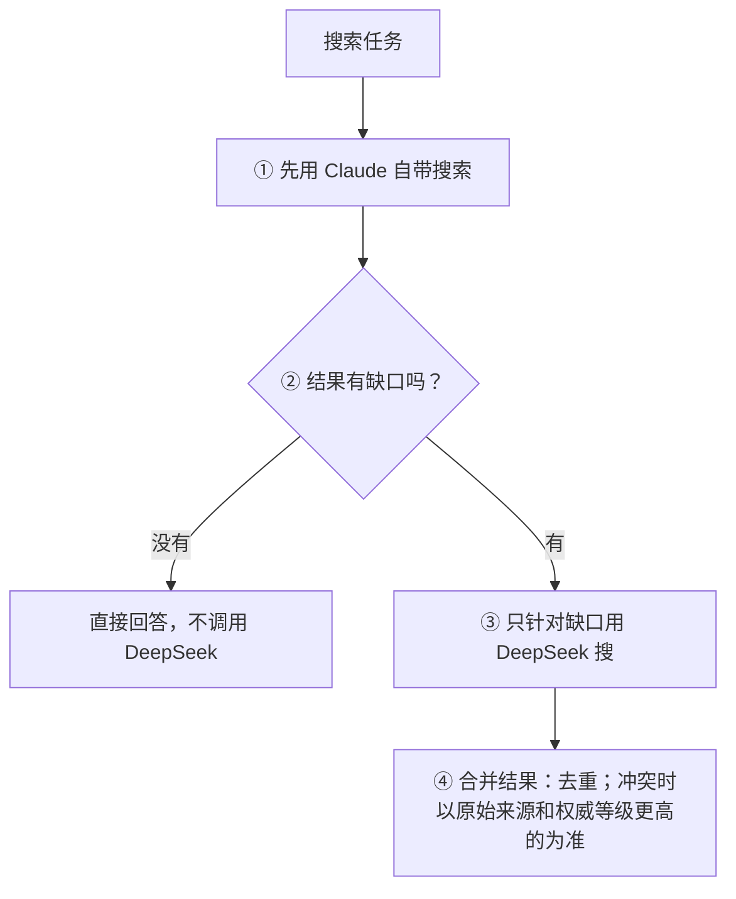

# DeepSeek Search MCP

[](https://github.com/lovwellcomm-cell/deepseek-search-mcp/actions/workflows/test.yml)
[](LICENSE)

简体中文 | [English](README.en.md)

给 Claude（桌面版 / Claude Code）接入 [DeepSeek 自研搜索引擎](https://api-docs.deepseek.com/guides/search)，作为 Claude 自带搜索的**补充**，专门弥补它在中文内容和中国本土信息上的覆盖短板。

```
你：腾讯 WorkBuddy 最近有什么新动态？

Claude：（先用自带搜索 → 发现最新结果停在两周前 → 自动调用 DeepSeek 只补最近两周）
        ……另用 DeepSeek 补充了国内来源：11 月 16 日，WorkBuddy 开放平台公布……
```

## 为什么做这个

Claude 自带的网页搜索擅长英文和全球资料，但碰到中国本土话题时，常常只能搜到英文的二手报道，缺少国内的一手来源，也跟不上国内的最新动态。DeepSeek 在 2026 年 10 月开放了自研搜索引擎的 API，中文覆盖面强，价格也低。

这个项目把两者结合起来，但**不是简单地分工**（"中文归 DeepSeek，英文归 Claude"），而是**补充**：



**5 个补充信号**（出现任意一个，Claude 才会调用 DeepSeek）：

1. **中文一手来源不足**：话题和中国有关，但结果大多是英文二手报道
2. **相关结果太少**：有用的结果不到 3 条，或者问题的某个方面没有覆盖到
3. **信息过时**：问的是最新情况，结果却都是旧内容
4. **关键结论只有一个来源**：用一个独立的搜索引擎交叉验证
5. **网页打不开**：Claude 自带的工具读不了某个页面时，改用 `deepseek_fetch`

为什么选"补充"而不是"分工"：
- **花钱更少**：只在真正需要时才调用，而不是每个中文问题都调用一次
- **主力不变**：Claude 自带搜索始终是第一选择，原有的使用体验基本不变
- **能交叉验证**：两个独立的搜索引擎互相核对关键事实，这是分工模式做不到的

这些规则同时写在两个地方，保证 Claude 看到的说法一致：MCP 服务器的工具说明（`server.py` 第七节），以及配套的 [Skill](skills/deepseek-search-routing/SKILL.md)。

## 功能

| 工具 | 作用 |
|---|---|
| `deepseek_search` | 搜索网页。返回标题、链接、网站名、日期、权威等级（0-4）、相关度分数和 600-800 字的摘要。支持 `site:`、`after:` 等搜索运算符，以及按时间范围筛选 |
| `deepseek_fetch` | 读取单个网页的全文（Markdown 格式），可以设置最多返回多少字 |

## 安全设计

这个项目要处理你的 API Key，还会在你的电脑上运行，所以在安全上做了这些设计：

- **接口地址写死**：Key 只会发往 `https://api.deepseek.com`。这个地址不能通过环境变量修改，也不会跟随网页跳转
- **报错信息里隐藏 Key**：任何报错信息中出现的 Key 都会被替换成 `sk-***`
- **依赖版本和哈希全部锁定**：`requirements.txt` 里每个依赖包都锁定了版本和文件哈希，被篡改的包会被拒绝安装（防范供应链攻击）
- **拦截内网地址**：`deepseek_fetch` 会拒绝 `localhost`、`192.168.x.x` 等内网地址
- **只读工具**：两个工具都标记为只读，不会修改任何东西
- **修改配置前先备份**：安装脚本修改 Claude 配置前会先备份原文件；如果配置文件格式有问题，会直接停下，不做任何修改
- **Key 存在本地文件里**：Key 保存在 `deepseek.key`，不写进 Claude 的配置文件；`.gitignore` 已经把它排除在外，不会被上传

## 支持的平台

| | Claude 桌面版 | Claude Code |
|---|---|---|
| Windows 10/11 | ✅ 已在真机测试 | ✅ |
| macOS（Apple Silicon / M 系列芯片） | ⚠️ 支持，但未在真机测试 | ⚠️ 支持，但未在真机测试 |
| macOS（Intel 芯片） | ❌ 有一个依赖包已不再提供 Intel Mac 版本 | ❌ |

需要 **Python 3.11 或更新版本**。

## 安装

### 1. 准备 DeepSeek API Key

到 [platform.deepseek.com](https://platform.deepseek.com) 充值少量余额（10 元足够用很久），然后在「API keys」页面创建一个 Key。

### 2. 下载本项目

```bash
git clone https://github.com/lovwellcomm-cell/deepseek-search-mcp.git
```

也可以在本页面点击 **Code → Download ZIP** 下载后解压。**放在一个固定的位置**，因为 Claude 每次启动都会从这个位置运行它，装好后不要再移动或改名。

### 3. 运行安装脚本

先**彻底退出 Claude 桌面版**（如果装了的话），然后：

- **Windows**：双击 `setup.bat`
- **macOS**：在终端里进入项目文件夹，运行 `bash setup.sh`

脚本会依次完成：
1. 建立独立的 Python 环境
2. 安装依赖（核对哈希）
3. 保存你的 Key
4. 可选的真实搜索自检
5. 加入 Claude 桌面版 和/或 Claude Code

### 4. 验证

- **Claude 桌面版**：重新打开 Claude，进入 设置 → 开发者，`deepseek-search` 应该显示为 running
- **Claude Code**：运行 `claude mcp list`，应该能看到 `deepseek-search`

### 5. 安装配套 Skill（推荐）

Skill 用来告诉 Claude 什么时候调用 DeepSeek、怎么用好它。

- **Claude 桌面版 / 网页版**：把 `skills/deepseek-search-routing` 文件夹打包成 zip，在 Claude 的 Skills 设置中上传
- **Claude Code**：把这个文件夹复制到 `~/.claude/skills/` 下

## 使用

平时正常提问就行。需要时 Claude 会自动调用 DeepSeek 补充，并在回答里说明。

- 想直接用 DeepSeek 搜：「用 deepseek 搜一下国内 AI 办公 Agent 的竞品」
- 某次对话不想用：「这次别用 deepseek」

## 费用

DeepSeek 按次收费：**每 1000 次成功请求 5 元**，搜索和读网页分开计算。失败、超时、搜不到结果都不收费。

每一次计费都会记录在项目文件夹里的 `usage.log`，可以对照 DeepSeek 后台的账单核对。

## 卸载

先退出 Claude，然后：
- **Windows**：双击 `uninstall.bat`
- **macOS**：运行 `bash setup.sh --uninstall`

卸载脚本会从 Claude 桌面版和 Claude Code 中移除这个 MCP（修改前同样会备份配置）。之后如果不再需要，可以直接删掉整个文件夹。

## 常见问题

**安装时提示"没找到 Claude 的配置文件"**

Claude 桌面版在不同版本、不同安装方式下，配置文件的位置不一样。打开 Claude → 设置 → 开发者 → 编辑配置，会弹出配置文件所在的文件夹。Windows 上把里面的 `claude_desktop_config.json` 拖到 `setup.bat` 图标上即可；也可以运行：

```bash
python install.py --config "配置文件的完整路径"
```

**依赖安装失败**

国内访问 PyPI 可能比较慢，安装脚本会提示改用清华镜像重试。哈希校验照样进行，镜像无法篡改包的内容。

**Claude 里看不到工具**

Windows 上查看日志：`%APPDATA%\Claude\logs\mcp-server-deepseek-search.log`

**提示 401 / 402**

401 表示 Key 无效，重新运行安装脚本换一个 Key。402 表示余额不足，需要去 DeepSeek 后台充值。

## 项目结构

```
├── server.py              MCP 服务器（全部逻辑都在这里，带详细的中文注释）
├── install.py             安装/卸载脚本（只用 Python 标准库）
├── requirements.txt       依赖清单（版本 + 哈希锁定）
├── setup.bat / uninstall.bat   Windows 一键安装 / 卸载
├── setup.sh               macOS 安装 / 卸载
├── skills/                配套 Skill
├── tests/test_server.py   测试（使用本机模拟服务器，不花钱）
└── .github/workflows/     GitHub 自动测试（Windows / macOS / Linux × Python 3.11 / 3.13）
```

## 开发

```bash
python -m venv .venv
.venv/bin/pip install --require-hashes --only-binary=:all: -r requirements.txt   # Windows：.venv\Scripts\pip
.venv/bin/python tests/test_server.py server.py
```

测试会在本机启动一个模拟的 DeepSeek 服务器，覆盖这些情况：结果整理、内容截断、限流重试、错误处理、Key 隐藏、内网地址拦截、用量记录。全程不访问真实的 DeepSeek，也不花钱。

想调整 Claude 调用 DeepSeek 的时机，修改 `server.py` 第七节的 `instructions` 和工具说明即可。

## 致谢

- [DeepSeek Search & Fetch API 文档](https://api-docs.deepseek.com/guides/search)
- [MCP Python SDK](https://github.com/modelcontextprotocol/python-sdk)
- 设计时参考了 [BryleXia/deepseek-search-fetch-mcp](https://github.com/BryleXia/deepseek-search-fetch-mcp)（MIT）在结果截断、重试和 URL 校验方面的思路

## 声明

本项目是个人开源项目，与 DeepSeek 和 Anthropic 均无关联。

## 许可证

[MIT](LICENSE)
